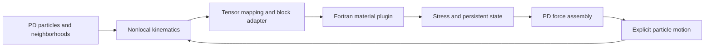

# VUMAT–PD

**Reuse constitutive material routines in correspondence peridynamics.**

VUMAT–PD connects compiled Fortran VUMAT-style routines to a standalone C++ peridynamic solver. Its reusable interface handles runtime plugin loading, tensor mapping, block-wise constitutive updates and persistent material history. The PD host retains responsibility for nonlocal kinematics, internal forces and particle motion. The supplied examples run without Abaqus.

This project implements the interface described in *VUMAT-PD: A plugin-based interface for VUMAT-driven peridynamic correspondence simulations*. The main contribution is constitutive reuse: a compatible material routine can serve a PD host without rewriting its material algorithm inside that solver.

[Architecture](docs/architecture.md) · [Material integration](docs/add-a-vumat.md) · [Interface contract](docs/interface.md) · [Particle demos](demos/README.md) · [Verification](benchmarks/tensile3d/README.md)

## What the interface enables

| Capability | What it provides | Where to explore |
|---|---|---|
| Runtime material plugins | Select a compiled Fortran material library through configuration; keep constitutive code separate from the PD solver. | [Add a material](docs/add-a-vumat.md) |
| Nonlocal-to-local coupling | Reconstruct PD deformation measures and map tensors into material input arrays; recover stress for PD force assembly. | [Coupling architecture](docs/architecture.md) |
| Block-wise material updates | Gather point data into contiguous blocks, invoke the VUMAT-style routine and scatter valid results back to particles. | [Block and tensor conventions](docs/interface.md) |
| Persistent constitutive history | Preserve each particle's stress, state variables and energy across increments. | [Johnson–Cook PD demo](demos/johnson-cook-tension/README.md) |
| Explicit stress-frame handling | Use the documented corotational route for Elastic/JC; use a dedicated spatial-stress route for the supplied Neo-Hookean demos. | [Frame conventions](docs/interface.md) |
| Reproducible verification | Check the material and coupling layers, retain original benchmark data and compare independent spatial formulations. | [3D benchmark](benchmarks/tensile3d/README.md) |



The material plugin never needs access to PD neighborhoods or bonds. A new routine supplies constitutive response through the interface; the PD host continues to assemble nonlocal forces and advance the body.

## Explore the PD demonstrations

Each demo has its own folder with a particle animation, final-state preview, setup, rerun commands and data provenance. Every colored point represents an actual PD particle at its computed deformed position. Free interior particles evolve under PD forces.

| Demo | What it illustrates | Open |
|---|---|---|
| Elastic tension | Elastic material reuse and dynamic stress propagation | [Demo folder](demos/elastic-tension/README.md) |
| Johnson–Cook tension | Elastoplastic updates and evolving particle history | [Demo folder](demos/johnson-cook-tension/README.md) |
| Neo-Hookean 150° bending | Finite deformation through the dedicated spatial-stress route | [Demo folder](demos/neohookean-bending/README.md) |
| Neo-Hookean 540° torsion | Large prescribed end rotation with PD interior motion | [Demo folder](demos/neohookean-torsion/README.md) |

These demonstrations expose different material paths. The Neo-Hookean examples extend the gallery beyond the paper's JC benchmark; they do not establish general finite-rotation accuracy or convergence.

## Verification supported by the paper

The paper evaluates constitutive-transfer consistency with a three-dimensional nonfracturing tensile benchmark. Both independent spatial solvers execute the same Johnson–Cook plugin under the same interface contract.

| Fine-resolution FEM–PD comparison | Reported result |
|---|---:|
| Mean axial stress difference | 0.17% |
| Stress-history NRMSE | 0.55% |
| Displacement RMSE / imposed displacement | 0.96% |
| Maximum local plastic-strain difference | 11.52% |

Mean stress and displacement agree closely for this case; local plastic strain remains resolution-sensitive. The [benchmark directory](benchmarks/tensile3d/README.md) contains the independent FEM reference, final PD cases, archived data and sensitivity metrics. FEM is a verification tool and is excluded from the installed PD runtime.

Standard Abaqus shear ordering and stretch conventions require explicit mapping for routines that depend on them. Additional materials and hosts need their own checks. Thermal calibration, general finite-rotation accuracy and production impact/fracture capability are outside the paper's verified scope. See [the interface contract](docs/interface.md) before integrating another routine.

## Build and start

Requirements: CMake 3.25+, C++17, gfortran, Ninja and OpenMP. Builds are checked with Windows MSYS2 UCRT64 and Ubuntu GCC/gfortran. Use an ASCII checkout path on Windows and place compiler runtimes on `PATH`.

```bash
cmake --preset release
cmake --build --preset release --parallel
ctest --preset release
python demos/run.py all --threads 2
```

The launcher runs all four PD cases and records the actual executables, plugins and result hashes. For a PD build without the FEM verification target:

```bash
cmake -S . -B build/pd-only -G Ninja -DCMAKE_BUILD_TYPE=Release -DBUILD_TESTING=OFF
cmake --build build/pd-only --parallel
```

Python 3.10+ is needed for the demo launcher. Plotting and movie generation also require the [demo dependencies](demos/requirements.txt) and FFmpeg. See [the demo index](demos/README.md) for particle-rendering commands.

## Repository map

```text
src/                  PD hosts and material coupling
include/              Public C++ interfaces
materials/            Fortran material routines and bridge
configs/              Material properties and plugin selection
examples/             PD inputs and small verification cases
demos/                Four demo folders and shared particle-rendering tools
benchmarks/tensile3d/  Independent validation inputs, data and metrics
docs/                 Architecture and integration guides
tests/                Automated numerical checks
```

Generated runs and builds are ignored by Git. The project uses the [BSD 3-Clause License](LICENSE). For reproducible bug reports or integration questions, use [GitHub issues](https://github.com/1998yu/vumat-pd/issues) and the [contribution guide](CONTRIBUTING.md).
