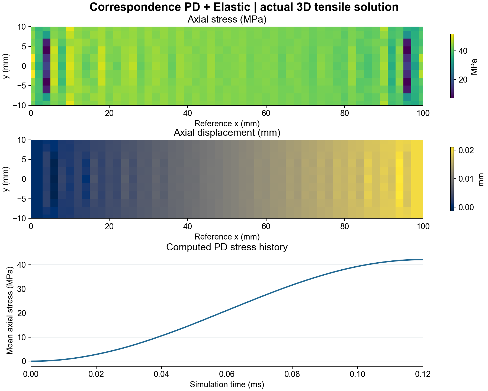
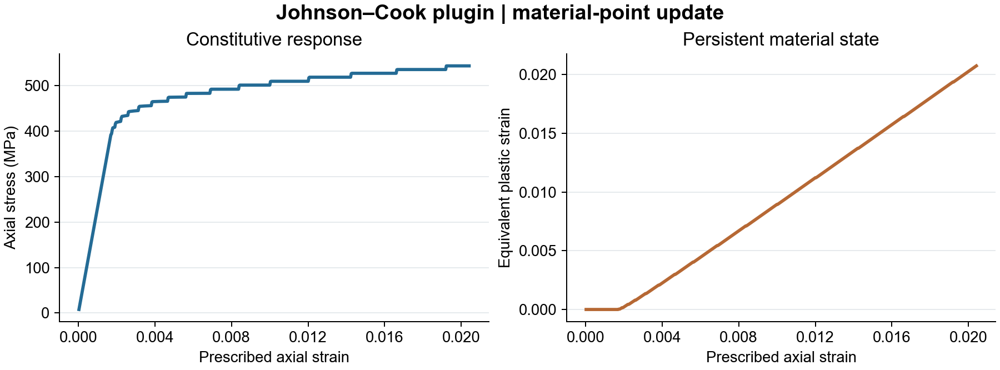
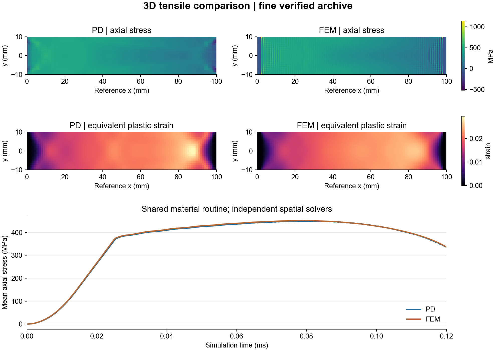
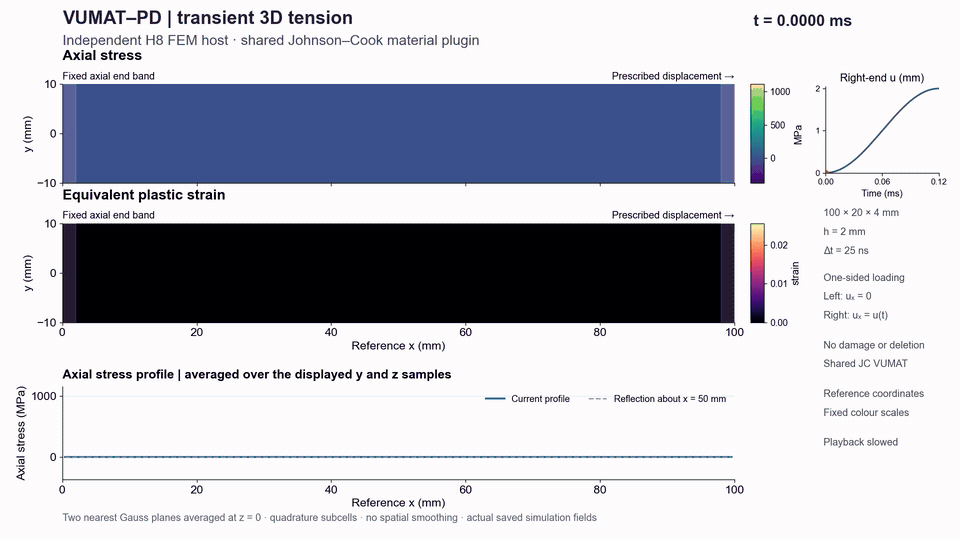
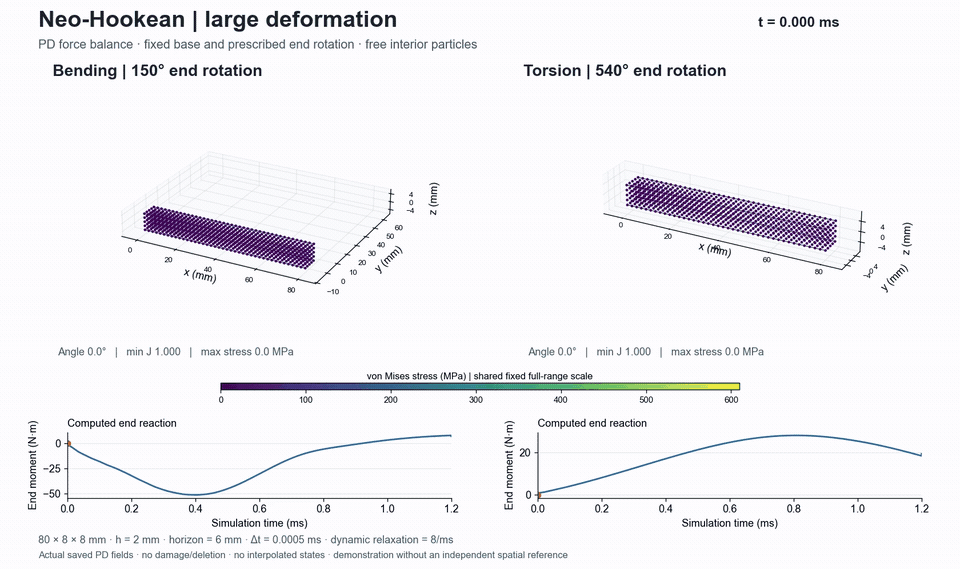

# VUMAT–PD

**Reuse a material routine in peridynamics. Build it once, load it as a plugin, and run a verified example.**

VUMAT–PD is a C++/Fortran interface for executing VUMAT-style constitutive updates inside a correspondence-peridynamics solver. It handles tensor mapping, corotational kinematics, block-wise calls and persistent material state, so that a new material does not need a second PD-specific implementation.

The project includes an explicit PD host, an independent 3D H8 finite-element comparison solver, three material plugins and five runnable demos. **Abaqus is not required to build or run the included examples.**

[Demos](demos/README.md) · [Integrate a VUMAT](docs/add-a-vumat.md) · [Interface conventions](docs/interface.md) · [Validation](benchmarks/tensile3d/README.md)

## See it run

### Elastic deformation

Check an elastic material plugin through affine extension and simple shear. The results are compared with the analytical small-strain response.



```bash
python demos/run.py elastic
```

### Johnson–Cook material point

Load the Fortran Johnson–Cook plugin and inspect its stress and equivalent-plastic-strain history before using it in a spatial model.



```bash
python demos/run.py material-point
```

### The same material in 3D FEM and PD

Run a matched 100 × 20 × 4 mm tensile specimen through independent FEM and PD spatial solvers. Both execute the same compiled material routine. Inspect the response history and the final stress and plastic-strain fields.



```bash
python demos/run.py tensile --threads 2
```

### Transient stress evolution

Watch the FEM tensile field evolve from the displaced end across the specimen. The moving time marker, fixed colour scales and reflected axial profile make the transient asymmetry visible.



[Download the full-resolution MP4](docs/media/transient.mp4).

```bash
python demos/run.py transient --threads 2
```

The gallery uses actual solver outputs. The animation shows FEM; the preceding demo compares FEM and PD. The nonfracturing specimen does not depict damage or crack propagation.

### Hyperelastic large deformation

Bend a 3D bar through 150° or twist it through 540° using the compressible Neo-Hookean material plugin. Free particles move under PD internal forces; only the support and loaded end layers have prescribed motion.



[Download the large-deformation MP4](docs/media/hyperelastic.mp4).

```bash
python demos/run.py hyperelastic
python demos/render_hyperelastic.py
```

These examples use dynamic relaxation and demonstrate finite-deformation behavior. They use a dedicated spatial-stress path, rather than the corotational JC path. The Neo-Hookean material check covers tension, compression, three shear planes, rigid rotation and rotated stretch; the spatial examples are demonstrations without an independent FEM or experimental reference. See [conditions and outputs](demos/README.md#5-hyperelastic-large-deformation).

## Quick start

Install CMake 3.25+, a C++17 compiler, a legacy-compatible Fortran compiler, Ninja and OpenMP. The configuration is tested with GCC/gfortran on Windows through MSYS2 UCRT64; the Ubuntu workflow builds and checks GCC/gfortran.

Run from the repository root:

```bash
cmake --preset release
cmake --build --preset release --parallel
ctest --preset release
python demos/run.py elastic
```

Python 3.10+ is used by the demo launcher and archive checker. Install the optional plotting dependencies to regenerate the gallery:

```bash
python -m pip install -r demos/requirements.txt
python demos/plot.py --demo elastic
```

The transient demo also requires FFmpeg on `PATH`. On Windows, use an ASCII-only checkout path and a terminal with the UCRT64 compiler runtimes on `PATH`. See [the demo guide](demos/README.md) for outputs and for the distinction between inspecting archived data and rerunning simulations.

## What you can reuse

| Component | Purpose |
|---|---|
| Runtime material plugins | Compile elastic, Johnson–Cook or Neo-Hookean Fortran routines into shared libraries |
| `VumatMaterialAdapter` | Transfer properties, tensors, energies and state arrays through block-wise calls |
| `VumatPdCorrespondenceMaterial` | Connect material updates to PD deformation measures and spatial stresses |
| Explicit PD host | Build neighborhoods, reconstruct kinematics, assemble forces and advance motion |
| 3D H8 FEM host | Compare the same constitutive routine through an independent spatial formulation |
| JSON cases and validation data | Start from documented inputs and check expected responses |

```text
PD nodal motion → nonlocal deformation gradient → corotational update
    → VUMAT material plugin → spatial stress → internal forces → next step
```

Adding a material means compiling a compatible plugin and writing its configuration. Start with [the VUMAT integration guide](docs/add-a-vumat.md); verify the material point before moving to a spatial case.

## Verification you can inspect

The automated checks cover corotational updates, neighbor search, elastic deformation, rigid-wall contact and an H8 affine patch. The [3D tensile benchmark](benchmarks/tensile3d/README.md) retains the final inputs, compressed raw data, hashes and comparison metrics.

For the fine matched FEM–PD case, archived stress-history NRMSE is **0.55%**, displacement RMSE is **0.96% of the imposed 2 mm displacement**, and local maximum plastic strain differs by **11.52%**. The tested JC update gives close averaged responses across the hosts, while local plastic strain remains more sensitive.

Final grid, horizon and time-step sensitivity cases are also included. Inspect them without rerunning the full matrix:

```bash
python benchmarks/tensile3d/analyse_and_plot.py
python benchmarks/tensile3d/verify_metrics.py
```

## Interface and scope

The adapter uses symmetric ordering **11, 22, 33, 23, 13, 12**, tensor shear and **left stretch**. These differ from standard Abaqus VUMAT shear ordering and right-stretch input. The included isotropic routines work under the documented conventions; an arbitrary VUMAT needs component/frame mapping and its own verification.

The 3D benchmark verifies a nonfracturing, x-directed tensile case. It establishes neither general finite-rotation accuracy nor a physically calibrated thermal response. The JC temperature state is a transferred numerical variable, not a validated adiabatic prediction. Existing damage/contact code does not establish production impact or fracture capability. Read [interface conventions and applicability](docs/interface.md) before adapting the project.

Use one OpenMP thread for a custom routine until its reentrancy has been checked. The JC plugin is built with recursive local Fortran storage for its tested threaded path.

## Project layout

```text
src/                  Single current C++ implementation
include/              Public C++ interfaces
materials/            Fortran examples and standalone bridge
configs/              Material properties and plugin configuration
examples/             Small runnable cases
demos/                Launcher, plotting and movie generation
benchmarks/tensile3d/  Final 3D validation inputs, data and metrics
docs/                 Architecture, integration guides and gallery
tests/                Automated checks
```

Builds, generated runs and logs are ignored by Git. The checkout contains the current implementation for affine PD checks, material-point updates, regional PD boundary cases and the dedicated hyperelastic bending/torsion demo. Comparison plots and exported tables can be regenerated from the final validation data.

## License and support

The project uses the [BSD 3-Clause License](LICENSE). The included materials are example routines. Use [GitHub issues](https://github.com/1998yu/vumat-pd/issues) for reproducible bug reports and integration questions. See [CONTRIBUTING.md](CONTRIBUTING.md) and [CITATION.cff](CITATION.cff).
