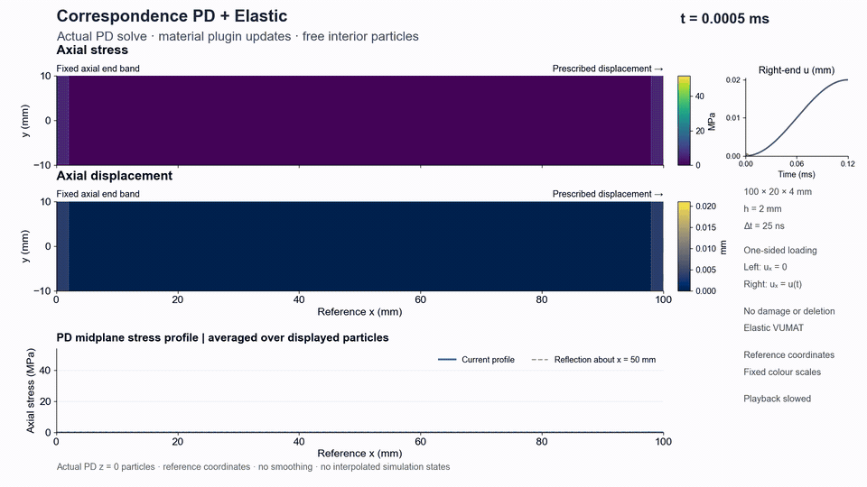
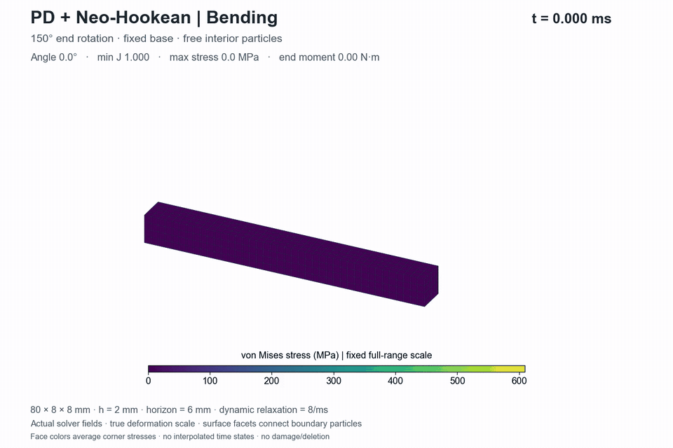
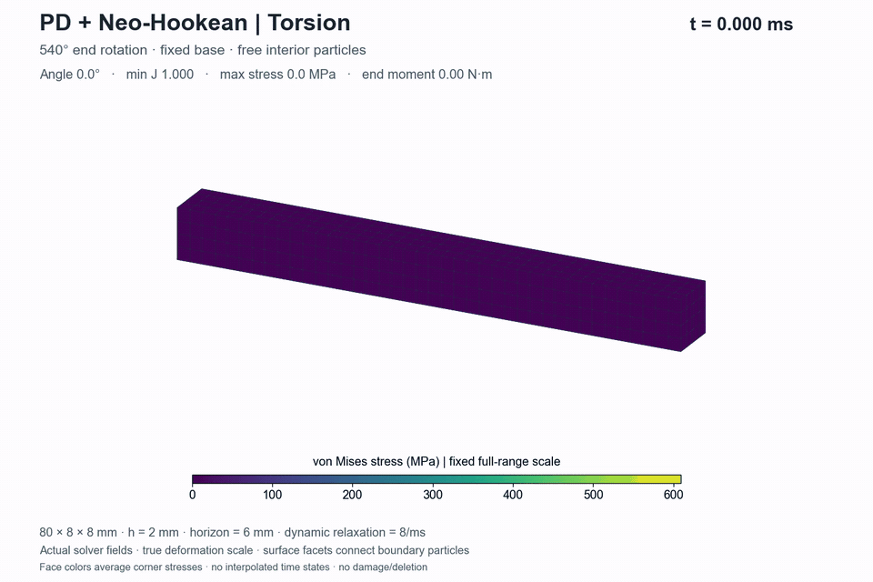

# VUMAT–PD

**Run peridynamic simulations with reusable Fortran material plugins.**

VUMAT–PD is a C++/Fortran correspondence-peridynamics project. The PD host reconstructs nonlocal deformation gradients, calls the selected material plugin, assembles PD internal forces and advances particle motion. Material state stays with each particle. Abaqus is not required for the supplied examples.

Every simulation displayed below is computed with **PD**. Elastic, Johnson–Cook and Neo-Hookean routines provide the corresponding constitutive response. Only support and loaded-end particles have prescribed motion; interior particles are solved from PD force balance.

[Architecture](docs/architecture.md) · [Run the PD demos](demos/README.md) · [Add a material](docs/add-a-vumat.md) · [Interface conventions](docs/interface.md)

## PD demos

### Elastic tension

Correspondence PD coupled to `Elastic.f`: a 100 × 20 × 4 mm bar, 0.02 mm end displacement over 0.12 ms, free lateral faces and no damage. The movie shows computed axial stress and displacement.



[MP4](docs/media/elastic.mp4) · [Field and history plot](docs/media/elastic.png)

```bash
python demos/run.py elastic
python demos/render_pd.py --case elastic
```

### Johnson–Cook elastoplastic tension

Correspondence PD coupled to `JohnsonCook.f90`: the same bar geometry, with 2 mm end displacement. The movie shows actual PD axial stress, equivalent plastic strain and the developing axial stress profile.


[MP4](docs/media/transient.mp4) · [Field and history plot](docs/media/tensile.png)

```bash
python demos/run.py tensile
python demos/render_pd.py --case jc
```

### Neo-Hookean 150° bending

A 3D PD bar coupled to `NeoHookeanKV.f90`, with constitutive viscosities set to zero. The prescribed end turns through 150°; interior particles deform under the computed PD forces.



[Bending MP4](docs/media/bending.mp4)

### Neo-Hookean 540° torsion

The same PD material path under a 540° end rotation. Bending and torsion are displayed independently, using true deformation scale and actual boundary-particle facets.



[Torsion MP4](docs/media/torsion.mp4)

```bash
python demos/run.py hyperelastic
python demos/render_hyperelastic.py
```

Both hyperelastic cases use an 80 × 8 × 8 mm bar and host dynamic relaxation of 8/ms. They demonstrate finite deformation and have no independent spatial FEM/experimental reference. Damage and deletion are disabled throughout the gallery.

## Build and rerun everything

Use CMake 3.25+, a C++17 compiler, gfortran, Ninja and OpenMP. GCC/gfortran builds are checked on Windows MSYS2 UCRT64 and in the Ubuntu workflow. On Windows, use an ASCII checkout path and put compiler runtimes on `PATH`.

```bash
cmake --preset release
cmake --build --preset release --parallel
ctest --preset release
python demos/run.py all --threads 2
```

The launcher always executes new simulations. Its four-case run manifest records the PD executable, loaded material plugin, checksums and output locations. See [the gallery run provenance](docs/media/pd_runs.json).

Python 3.10+ is used for orchestration. To regenerate figures and videos, install the plotting dependencies and FFmpeg (`ffmpeg` and `ffprobe` on `PATH`):

```bash
python -m pip install -r demos/requirements.txt
python demos/plot.py --demo elastic
python demos/plot.py --demo tensile
python demos/render_pd.py --case elastic
python demos/render_pd.py --case jc
python demos/render_hyperelastic.py
```

## Shared interface and verification

`VumatMaterialAdapter` handles compiled material libraries, tensor packing, block calls and persistent state. Elastic/JC spatial cases use the corotational coupling wrapper; the supplied Neo-Hookean demo uses spatial deformation gradients and spatial Cauchy stress directly. These frame conventions require explicit mapping when integrating another routine. Read [the interface guide](docs/interface.md).

Affine checks, material-point checks and the independent H8 FEM solver are **verification tools**. The [3D tensile benchmark](benchmarks/tensile3d/README.md) retains matched JC FEM–PD comparisons, final sensitivity cases, original data hashes and metric baselines. FEM outputs and material-point histories are not used as PD demo footage.

The archived fine JC pair gives 0.55% stress-history NRMSE, displacement RMSE of 0.96% of the imposed displacement and an 11.52% difference in local maximum plastic strain. These figures describe that benchmark; they do not validate every material or application.

The JC temperature state is numerical history, not calibrated adiabatic heating. Existing contact/damage code does not establish production fracture or impact capability. Start a custom routine with one thread until its reentrancy has been checked.

## Project layout

```text
src/                  PD hosts and material coupling
include/              Public C++ interfaces
materials/            Fortran material routines and standalone bridge
configs/              Material properties and plugin configuration
examples/             PD inputs and small verification cases
demos/                PD launcher, plotting and movie generation
benchmarks/tensile3d/  Independent validation inputs, data and metrics
docs/                 Architecture, integration guides and PD gallery
tests/                Automated numerical checks
```

Generated outputs and build files are ignored by Git. The [BSD 3-Clause License](LICENSE) covers the project. Use [GitHub issues](https://github.com/1998yu/vumat-pd/issues) for reproducible bug reports and integration questions; see [CONTRIBUTING.md](CONTRIBUTING.md).
