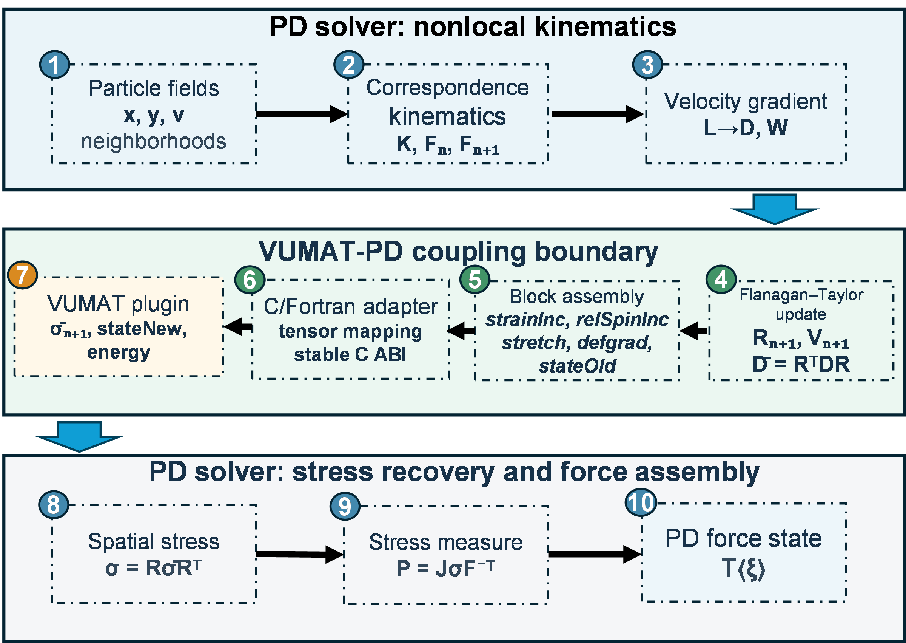
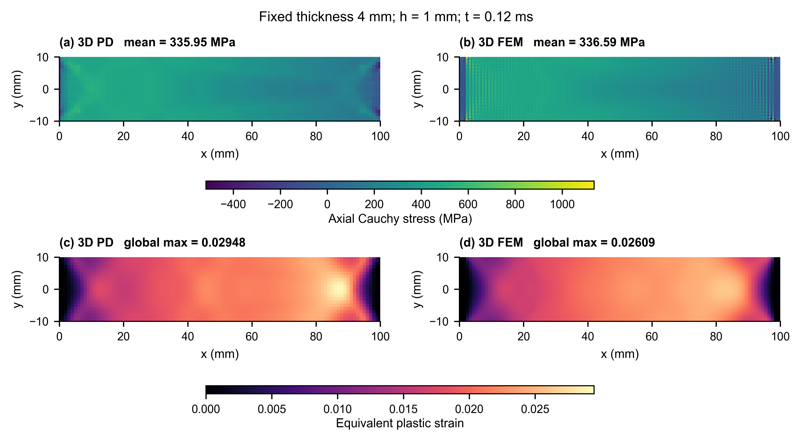
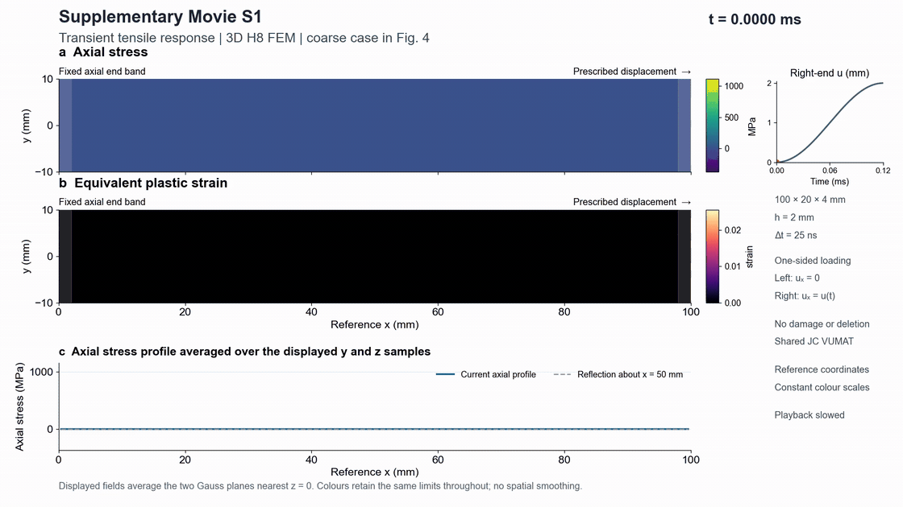
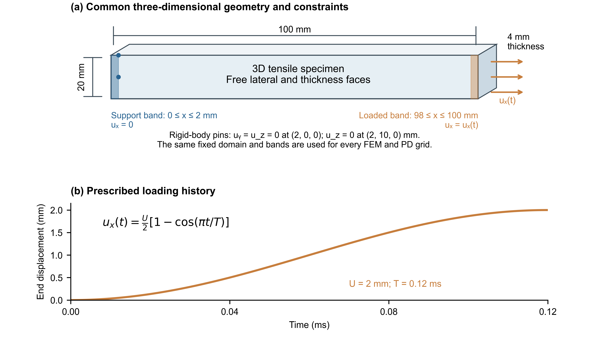
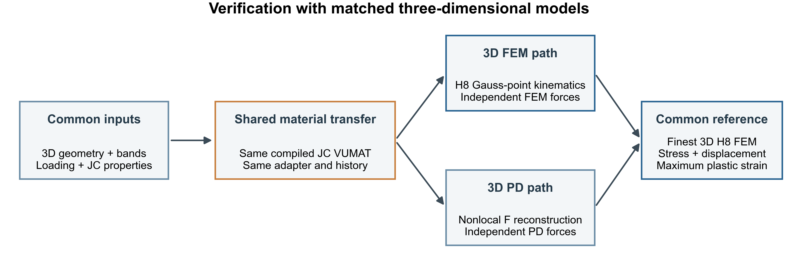
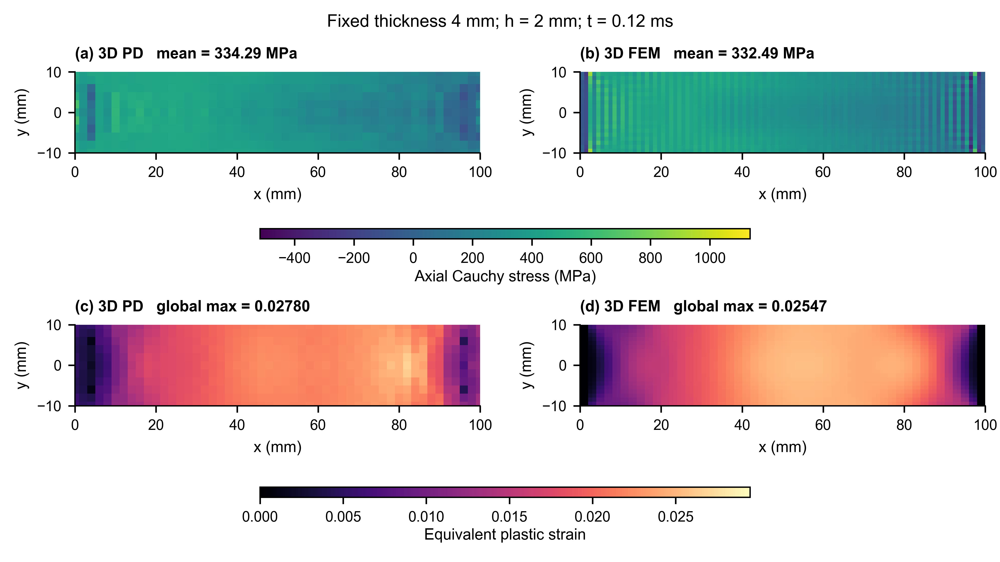
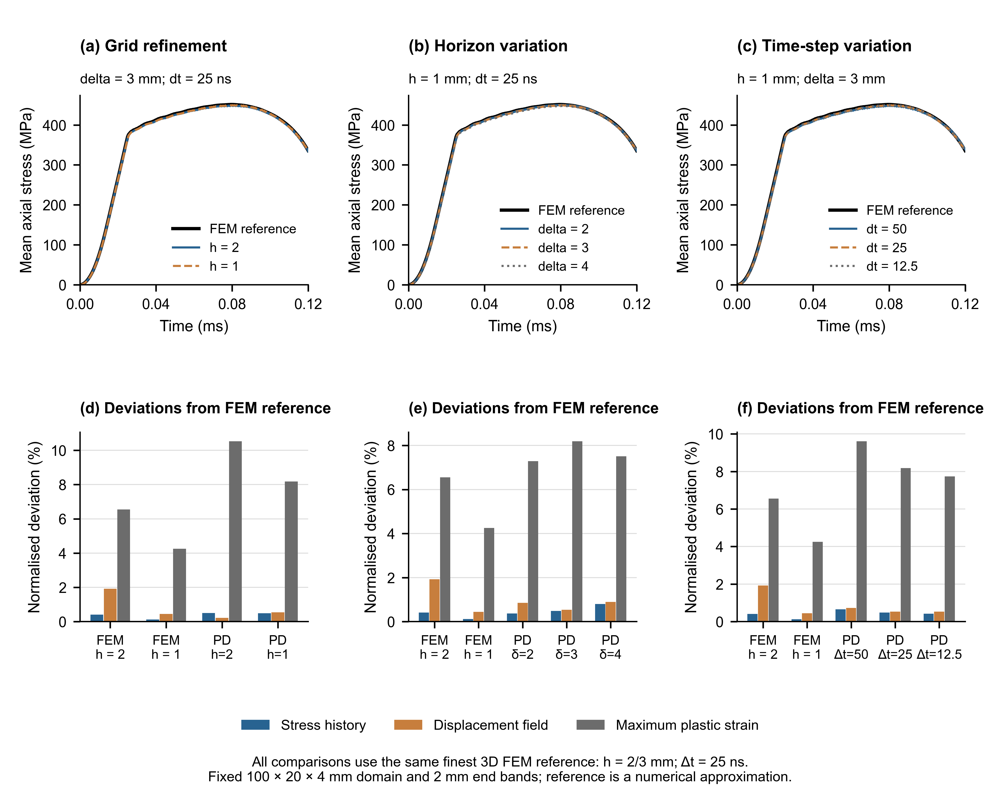

# VUMAT–PD

**Reuse existing material routines in correspondence peridynamics.**

VUMAT–PD connects compiled Fortran VUMAT-style routines to a standalone C++ PD solver. The interface handles runtime plugin loading, tensor mapping, block-wise constitutive updates and persistent material history. The PD host handles particle neighborhoods, nonlocal kinematics, internal forces and explicit motion. The supplied examples run without Abaqus.

The project implements the interface described in *VUMAT-PD: A plugin-based interface for VUMAT-driven peridynamic correspondence simulations*. Its central capability is constitutive reuse: integrate a compatible material routine without rewriting its material algorithm inside the PD solver.

[Architecture](docs/architecture.md) · [Add a material](docs/add-a-vumat.md) · [Interface contract](docs/interface.md) · [PD particle demos](demos/README.md) · [Verification](benchmarks/tensile3d/README.md)

## How the coupling works



*The coupling workflow from the manuscript: nonlocal PD kinematics → objective material inputs → compiled VUMAT plugin → spatial stress recovery and PD force assembly.*

The plugin receives material-point arrays rather than neighborhoods or bonds. The coupling layer gathers particle data into blocks, applies the declared tensor and frame conventions, invokes the material routine and returns updated stress, state and energy. Each particle retains its material history across increments.

## What you can use

| Capability | Project support |
|---|---|
| Reusable constitutive plugins | Select a compiled Fortran material library and its properties through configuration. |
| Block-wise material updates | Maintain point-to-row ownership, tensor ordering and state transfer through the shared adapter. |
| Correspondence PD simulation | Reconstruct deformation measures, recover spatial stress and assemble nonlocal particle forces. |
| Different material paths | Elastic and Johnson–Cook use the corotational coupling route; the supplied Neo-Hookean demos use a dedicated spatial-stress route. |
| Optional outer damage | Retain pointwise degradation and critical-stretch bond attenuation outside the VUMAT update. See [damage configuration](docs/outer-damage.md). |
| Reproducible verification | Material-point checks, coupling checks, archived 3D comparisons and parameter-sensitivity studies. |

Start with [the material integration guide](docs/add-a-vumat.md). The [interface contract](docs/interface.md) explains shear ordering, left/right stretch and stress-frame conventions that must be mapped explicitly for another routine.

## Material-transfer verification

The manuscript tests the same Johnson–Cook plugin in independent 3D PD and H8 FEM formulations. Both use a 100 × 20 × 4 mm body and a smooth 2 mm end displacement over 0.12 ms. FEM provides an independent verification reference; the project runtime and all four demo simulations use PD.



*Fine-resolution fields from the manuscript. The two formulations reproduce similar stress and plastic-strain distributions; the local plastic-strain maximum remains resolution-sensitive.*

| Matched fine-resolution comparison | Result |
|---|---:|
| Final mean axial stress difference | 0.19% |
| Stress-history NRMSE | 0.55% |
| Displacement RMSE / imposed displacement | 0.96% |
| Maximum local plastic-strain difference | 11.50% |

These results support constitutive-transfer consistency for the documented nonfracturing JC case. They do not establish universal VUMAT compatibility or full convergence.

### 3D FEM tensile response — verification movie



[Watch/download the verification MP4](benchmarks/tensile3d/media/fem-tension.mp4) · [Movie provenance](benchmarks/tensile3d/media/fem-tension.json)

*Supplementary Movie S1 from the coarse 3D H8 FEM benchmark: axial stress and equivalent plastic strain evolve over 0–0.12 ms under one-sided end displacement. The displayed fields average the two nearest mid-thickness Gauss planes. This movie supports independent verification; the four runnable particle demos use PD.*

<details>
<summary>Geometry, verification pathway and coarse-grid fields</summary>



*Fixed 100 × 20 × 4 mm geometry, free lateral/thickness faces and 2 mm end bands.*



*Shared material input and plugin; independent kinematic reconstruction and internal-force assembly.*



*Coarse comparison at h = 2 mm and PD horizon = 6 mm. These are verification fields, separate from the discrete-particle demo views.*

</details>

## Spatial and temporal sensitivity

The benchmark also varies PD grid spacing, horizon and time step against one finest H8 FEM numerical reference. Stress histories are more stable than local plastic-strain maxima; parameter refinement does not reduce every deviation monotonically.

<details>
<summary>View the manuscript's sensitivity results</summary>



*For the fine PD baseline, stress-history, displacement and maximum-plastic-strain deviations are 0.483%, 0.538% and 8.186%. These use the finest FEM reference and differ from the matched-pair metrics above.*

</details>

The [benchmark directory](benchmarks/tensile3d/README.md) preserves the corrected publication data hashes, final case inputs, separate metric baselines and reproduction tools. Browse [all six manuscript figures](docs/paper-figures/README.md) and their source traceability.

## Explore the PD particle demos

Each demo folder contains its own setup, discrete-particle animation, final-state preview, rerun commands and provenance. Every colored point is an actual PD particle at its computed deformed position. Free interior particles evolve under PD forces.

| Demo | What it shows | Open |
|---|---|---|
| Elastic tension | Material reuse and transient elastic stress | [Demo folder](demos/elastic-tension/README.md) |
| Johnson–Cook tension | Elastoplastic stress and persistent material history | [Demo folder](demos/johnson-cook-tension/README.md) |
| Neo-Hookean 150° bending | Finite deformation through the dedicated spatial-stress route | [Demo folder](demos/neohookean-bending/README.md) |
| Neo-Hookean 540° torsion | Large end rotation and computed PD interior motion | [Demo folder](demos/neohookean-torsion/README.md) |

The Neo-Hookean demos extend the gallery beyond the paper's JC benchmark; they have no independent spatial FEM/experimental reference. All four gallery cases disable the optional outer damage layer.

## Optional outer damage

`SimpleDamageModel` and `PdSimpleDamage` remain available with their host calls and configuration. Point modes use material-state or principal-strain thresholds; the bond mode uses critical stretch. This host layer is separate from the constitutive routine's raw stress and persistent history. Its algorithmic checks cover degradation, irreversibility and bond failure; they do not validate physical fracture applications. Read [the damage guide](docs/outer-damage.md) before enabling it.

## Build and start

Requirements: CMake 3.25+, C++17, gfortran, Ninja and OpenMP. Builds are checked with Windows MSYS2 UCRT64 and Ubuntu GCC/gfortran. Use an ASCII checkout path on Windows and place compiler runtimes on `PATH`.

Clone the project, enter its root directory and build with the GNU compiler tools available on `PATH`:

```bash
git clone https://github.com/1998yu/vumat-pd.git
cd vumat-pd
```

```bash
cmake --preset release
cmake --build --preset release --parallel
ctest --preset release
```

Python 3.10+ is used for orchestration. Install the plotting dependencies before post-processing; MP4/GIF export also requires `ffmpeg` and `ffprobe` on `PATH`:

```bash
python -m pip install -r demos/requirements.txt -r benchmarks/tensile3d/requirements.txt
```

Run a single elastic PD example and render its particles:

```bash
python demos/run.py elastic --threads 2
python demos/render_particles.py --case elastic
```

The simulation writes CSV fields and histories to `demos/output/elastic_pd`. The renderer writes the MP4, GIF, final PNG and source-provenance JSON to `demos/output/particles/elastic-tension`. The launcher records the actual executables, plugins and result hashes in `demos/output/run_manifest.json`. To generate images without video encoding, use `--preview-only` on the renderer.

Recompute and display all four PD demos:

```bash
python demos/run.py all --threads 2
python demos/render_particles.py --case all
```

For individual JC, bending and torsion commands, case definitions and output locations, see [the demo guide](demos/README.md). Start a new material routine with one thread until its reentrancy has been checked.

For a PD runtime build without FEM or standalone verification executables:

```bash
cmake -S . -B build/pd-only -G Ninja -DCMAKE_BUILD_TYPE=Release -DBUILD_TESTING=OFF
cmake --build build/pd-only --parallel
```

## Reproduce the verification results

To inspect the published numerical evidence without running new simulations, expand the checked archive, regenerate its plots and compare the metrics with the frozen baselines:

```bash
python benchmarks/tensile3d/analyse_and_plot.py
python benchmarks/tensile3d/verify_metrics.py
```

This verifies the checksums of 26 archived CSV files and regenerates figures, sampled coordinates and quantitative comparisons under `benchmarks/tensile3d/generated`. Matched FEM–PD comparisons and comparisons with the finest FEM reference use separate baselines.

To recompute the complete validation matrix with the compiled solvers:

```bash
python benchmarks/tensile3d/run_cases.py --threads 2 --workers 1 --overwrite
python benchmarks/tensile3d/analyse_and_plot.py --results benchmarks/tensile3d/generated/results
python benchmarks/tensile3d/verify_metrics.py
```

The matrix includes the independent H8 FEM reference and requires a build with `BUILD_TESTING=ON`, as used by the release preset. It is more expensive than a single PD demo. See [the benchmark guide](benchmarks/tensile3d/README.md) for selected cases, reference definitions, tolerances and optional FEM movie snapshots.

## Developer documentation

| Guide | What it explains |
|---|---|
| [Architecture](docs/architecture.md) | PD hosts, material adapter, plugin boundaries and verification responsibilities |
| [Add a material](docs/add-a-vumat.md) | Compile a compatible VUMAT, configure properties/history and check its integration |
| [Interface conventions](docs/interface.md) | Component order, stress frames, stretch tensors, thermal history and threading |
| [Corotational kinematics](docs/kinematics.md) | Deformation reconstruction, corrected rotation update and its numerical limits |
| [Outer damage](docs/outer-damage.md) | Optional point/bond degradation, configuration and unvalidated fracture scope |

## Scope and reuse

The demonstrated scope is material transfer under the documented interface conventions. Standard Abaqus shear ordering and stretch conventions require explicit mapping for affected routines. Additional materials and hosts need separate checks. Thermal calibration, general finite-rotation accuracy and production impact/fracture capability remain outside the paper's verified scope.

```text
src/                  PD hosts, material coupling and optional outer damage
include/              Public C++ interfaces
materials/            Fortran material routines and bridge
configs/              Material properties and plugin selection
examples/             PD inputs and small verification cases
demos/                Four particle-demo folders and shared rendering tools
benchmarks/tensile3d/  Independent validation inputs, data and metrics
docs/                 Integration guides and manuscript figures
tests/                Automated numerical checks
```

Generated runs and builds are ignored by Git.

## License and support

The project uses the [BSD 3-Clause License](LICENCE.txt). The root `LICENCE.txt` contains the complete license required for SoftwareX submission; `LICENSE` carries the same terms for standard repository license discovery.

For reproducible bug reports or integration questions, use [GitHub issues](https://github.com/1998yu/vumat-pd/issues) and the [contribution guide](CONTRIBUTING.md). Include the code revision, platform, compiler versions, case input, executed command and relevant error output. The manuscript identifies the frozen software revision used for its numerical results.
