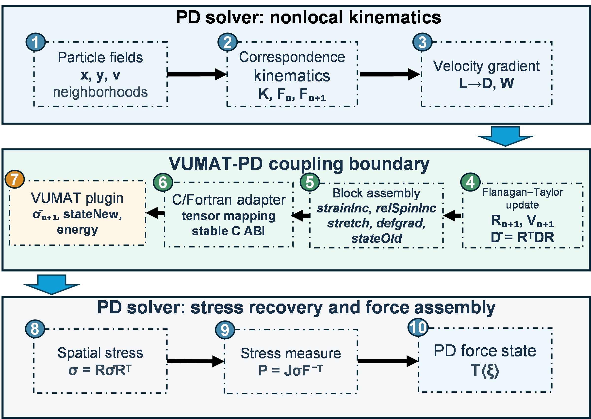
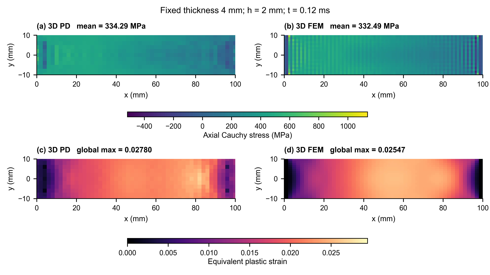
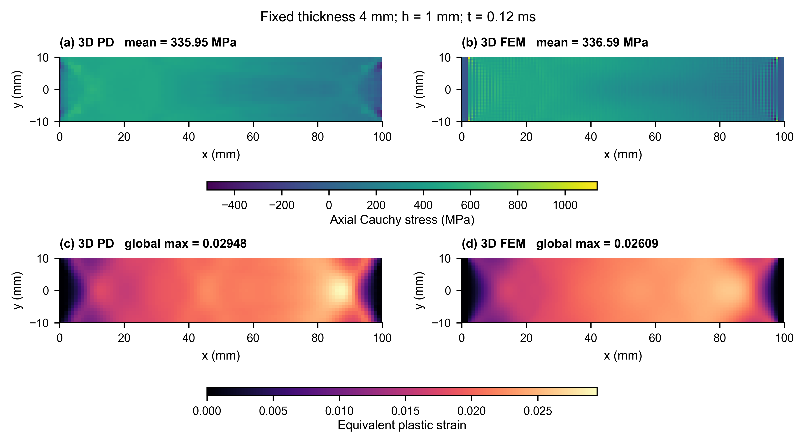
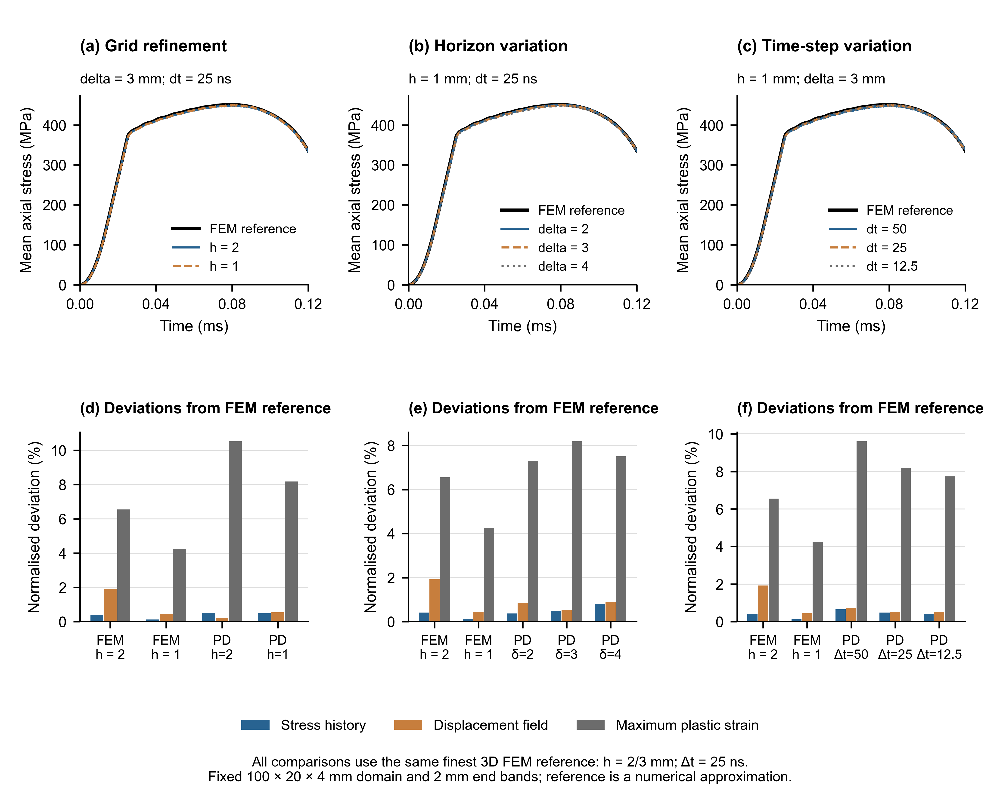

# VUMAT-PD
Use VUMAT-PD to run a compatible Fortran material routine in a standalone C++ correspondence-peridynamics solver. Start with the included Johnson–Cook routine to see how material properties, stress and state variables pass through the interface. Then use the same workflow to check a routine of your own before running it in PD.

| What you want to do | Where to start |
|---|---|
| Run a small example | [Johnson–Cook material point](#run-the-minimal-example) |
| Bring your own material routine | [Plugin integration guide](docs/add-a-vumat.md) and [tensor and state conventions](docs/interface.md) |
| Follow a time increment through the code | [Architecture and source map](docs/architecture.md) |
| Reproduce the paper’s PD and H8 FEM comparison | [Benchmark workflow](#reproduce-the-paper-results) |

The shared Johnson–Cook plugin runs in both hosts. This lets you inspect how each host supplies kinematics and uses the returned stress while keeping the constitutive routine fixed. Compatibility depends on the component order, stress frame and state layout documented in the interface guide.

## Which directory should I open?

| Directory | Start here when you want to… |
|---|---|
| [examples/](examples/) | **Learn how to use VUMAT-PD.** Run the small Johnson–Cook material-point example and inspect its stress and history output before trying your own material. |
| [tests/](tests/) | **Check a code change.** Run CTest to check specific behavior such as tensor ordering, material history transfer, and rotation updates. Each check has a pass or fail criterion. |
| [benchmarks/](benchmarks/tensile3d/) | **Reproduce the paper's numerical results.** Run the tensile cases or use the archived outputs to compare PD with H8 FEM and regenerate the reported metrics. |

Case inputs are stored once. CTest runs the same `examples/jc_material_point.json` file used in the quick start. The benchmark keeps separate inputs for runs that vary the grid, horizon, or time step because each run measures a different numerical effect.

## See what the software reproduces



The diagram shows where the material plugin fits into one PD increment. The paper compares PD and H8 FEM with the same Johnson–Cook routine. At matched fine resolution, the stress-history NRMSE is 0.55%, the displacement RMSE divided by the imposed displacement is 0.96%, and the maximum local plastic-strain difference is 11.50%.

### PD and H8 FEM at matched resolutions



*Figure 4. Coarse-grid comparison of axial stress and equivalent plastic strain.*



*Figure 5. Fine-grid comparison for the same loading and material routine.*

### Sensitivity to discretisation



*Figure 6. PD deviations from the finest H8 FEM reference as grid spacing, horizon and time step vary. These comparisons use a common reference, while Figures 4 and 5 pair PD and FEM at matched resolutions.*

[Paper figures and provenance](docs/paper-figures/README.md) · [Supplementary Movie S1](benchmarks/tensile3d/media/fem-tension.mp4)

## Run the minimal example

Use CMake 3.25+, Ninja, GNU C++/Fortran, OpenMP and Python. Run from the repository root.

```sh
cmake --preset release
cmake --build --preset release
ctest --preset release
./build/release/bin/vumat_pd_run examples/jc_material_point.json
```

On Windows use vumat_pd_run.exe. The example writes stress and material history to `examples/output/jc_material_point/timeseries.csv`. Use the integration guide to replace the supplied plugin and verify your own routine at a material point before coupling it to PD.

## Reproduce the paper results

```sh
python -m pip install -r benchmarks/tensile3d/requirements.txt
python benchmarks/tensile3d/unpack_archive.py
python benchmarks/tensile3d/analyse_and_plot.py
python benchmarks/tensile3d/verify_metrics.py
```

To run a new coarse PD/H8 pair, use `python benchmarks/tensile3d/run_cases.py --cases fem_coarse pd_coarse`.

See the [benchmark guide](benchmarks/tensile3d/README.md) for the full matrix, tolerance definitions and Supplementary Movie S1.
