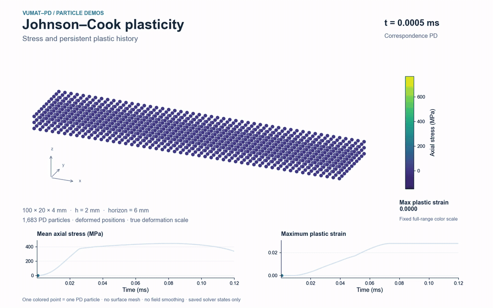

# Johnson–Cook elastoplastic tension

[Project capabilities](../../README.md) · [Demo index](../README.md)

This case illustrates persistent plastic state in a dynamic correspondence-PD simulation. Particle colors show axial stress. The response curves track mean axial stress and maximum equivalent plastic strain.



[High-quality MP4](media/particles.mp4) · [Final-state preview](media/overview.png) · [Editable SVG](media/overview.svg) · [Rendering provenance](media/particles.json)

## Setup

| Item | Setting |
|---|---|
| Solver | Correspondence peridynamics |
| Material routine | [JohnsonCook.f90](../../materials/examples/JohnsonCook.f90) |
| Geometry and loading | 100 × 20 × 4 mm; 51 × 11 × 3 particles; end displacement 2 mm |
| Discretization and time integration | 2 mm spacing; 6 mm horizon; 4800 increments of 25 ns; duration 0.12 ms |

The 2 mm axial end bands carry a half-cosine displacement ramp. Lateral and thickness faces are free; rigid-body pins remove transverse drift. Other particles move under PD force balance. Boundary-cell volumes are clipped to the body.

Corotational Johnson–Cook coupling. No damping, mass scaling, damage or deletion. The temperature state is numerical history, not calibrated adiabatic heating.

[PD input](../../examples/jc_tension_pd.json) · [Material configuration](../../configs/johnson_cook.json) · [Interface conventions](../../docs/interface.md)

## Reproduce

After building, run these commands from the repository root:

```bash
python demos/run.py tensile
python demos/render_particles.py --case jc
```

Use `--preview-only` on the renderer to save initial, middle and final PNGs without encoding a video. Generated particle media appear in `demos/output/particles/johnson-cook-tension`. The shared [rendering guide](../README.md#recompute-and-render) lists Python/FFmpeg dependencies.

## What the view represents

Every colored point is one actual PD particle at its saved deformed 3D coordinates. A fixed orthographic camera preserves equal physical scale. Marker size improves readability and does not represent particle volume. Stress uses a fixed full-history color scale; there is no surface mesh, smoothing or interpolation between saved states.

The [media provenance](media/particles.json) records the particle count, source CSV hashes, actual time range and verified video hash. The [four-case run manifest](../provenance.json) identifies the executed PD programs and material plugins. FEM results are not used in this animation.
