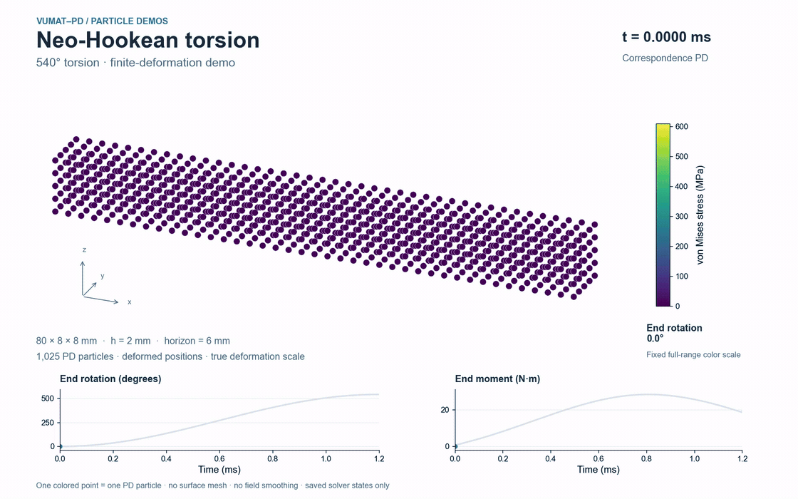

# Neo-Hookean 540° torsion

[Project capabilities](../../README.md) · [Demo index](../README.md)

This finite-deformation demo shows a 540° loaded-end rotation. The free interior particles move under computed PD forces. Colored particles show actual deformed positions and von Mises stress; the faint gray cloud is the initial shape. Curves show end angle and reaction moment.



[High-quality MP4](media/particles.mp4) · [Final-state preview](media/overview.png) · [Rendering provenance](media/particles.json)

## Setup

| Item | Setting |
|---|---|
| Solver | Correspondence peridynamics |
| Material routine | [NeoHookeanKV.f90](../../materials/examples/NeoHookeanKV.f90) |
| Geometry and loading | 80 × 8 × 8 mm; 41 × 5 × 5 particles; end rotation 540° |
| Discretization and time integration | 2 mm spacing; 6 mm horizon; 2400 increments of 0.0005 ms; duration 1.2 ms |

Three base layers are fixed, and three loaded layers follow a smooth rigid-motion ramp. All other particles advance under PD forces. Boundary-cell volumes are clipped to the body. This spatial demonstration has no independent FEM/experimental reference or convergence study.

Spatial deformation gradient → spatial Cauchy stress, without an extra corotational stress rotation. E = 2000 MPa; nu = 0.30; constitutive viscosities zero; host dynamic relaxation 8/ms. No damage/deletion.

[Material configuration](../../configs/neohookean.json) · [Interface conventions](../../docs/interface.md)

## Reproduce

After building, run these commands from the repository root:

```bash
python demos/run.py hyperelastic
python demos/render_particles.py --case torsion
```

The renderer also exports an editable SVG to the ignored output folder when needed. Use `--preview-only` on the renderer to save initial, middle and final PNGs without encoding a video. Generated particle media appear in `demos/output/particles/neohookean-torsion`. The shared [rendering guide](../README.md#recompute-and-render) lists Python/FFmpeg dependencies.

## What the view represents

Every colored point is one actual PD particle at its saved deformed 3D coordinates. A fixed orthographic camera preserves equal physical scale. Marker size improves readability and does not represent particle volume. Stress uses a fixed full-history color scale; there is no surface mesh, smoothing or interpolation between saved states.

The [media provenance](media/particles.json) records the particle count, source CSV hashes, actual time range and verified video hash. The [four-case run manifest](../provenance.json) identifies the executed PD programs and material plugins. FEM results are not used in this animation.
