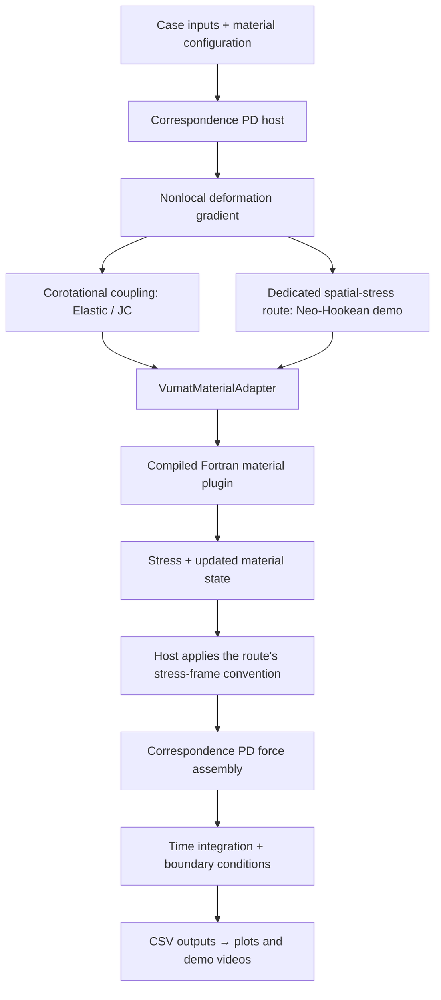

# Architecture

VUMAT–PD is a correspondence-peridynamics framework with reusable material plugins. Its C++ PD host handles particle geometry, nonlocal kinematics, PD force assembly and time integration; Fortran plugins provide constitutive response. The adapter connects them through a documented tensor and state-array contract. All gallery simulations run through this PD framework.

## Repository map

```text
vumat-pd/
├── src/                   PD implementation and runtime entry points
├── include/               Public C++ interfaces
├── materials/
│   ├── examples/          Elastic, Johnson–Cook and Neo-Hookean routines
│   └── bridge/            C-compatible Fortran wrapper and standalone shims
├── configs/               Material properties and plugin selection
├── examples/              Small case inputs
├── demos/                 Launcher, plots and video renderers
├── benchmarks/tensile3d/   Validation cases, data and independent FEM reference
├── docs/                  Architecture, integration guides and media
├── tests/                 Automated numerical checks
├── CMakeLists.txt         Build targets
└── .github/workflows/     Linux build and verification
```

Generated runs, temporary plots and compiler outputs are excluded from Git.

## Material update routes



`VumatMaterialAdapter` loads a material library, packs block inputs and unpacks stress, energy and persistent state arrays. It can be reused independently of the included spatial hosts. The bridge exports `vumat_adapter_call`; no Abaqus installation is needed for the examples.

`VumatPdCorrespondenceMaterial` manages the corotational route, including rotation, left stretch and material history. The host rotates the returned corotational stress into the spatial frame before assembling forces.

The Neo-Hookean bending/torsion entry calls `VumatMaterialAdapter` directly with spatial deformation gradients. Its material routine returns spatial Cauchy stress, so this route applies no extra corotational stress rotation. The two routes must not be interchanged without a frame conversion. See [interface conventions](interface.md).

## Runnable entry points

| Entry | Role |
|---|---|
| `vumat_pd_run` | Affine PD checks, material-point updates and regional PD boundary cases |
| `vumat_pd_large_motion_3d` | Dedicated Neo-Hookean 150° bending and 540° torsion examples |
| `python demos/run.py` | Select and launch the supported demos |
| `python demos/plot.py` | Plot freshly computed Elastic/JC PD fields and histories |
| `python demos/render_pd.py` | Render actual Elastic/JC PD transient fields |
| `python demos/render_hyperelastic.py` | Render bending and torsion as separate videos |

## Verification and reuse

PD checks cover neighborhood construction, corotational updates, affine response, basic contact and the actual Elastic/JC tensile solves. The Neo-Hookean material check covers finite stretch, three shear planes and rotation. The tensile benchmark retains independent FEM–PD comparisons and sensitivity cases.

The independent H8 FEM reference is located at `benchmarks/tensile3d/src/main_jc_3d_fem.cpp`. It is built as `jc_3d_fem` when `BUILD_TESTING=ON` and has an H8 patch check. It belongs to the verification workflow, is excluded from the installed PD runtime, and is not invoked by any demo command. Configure with `BUILD_TESTING=OFF` for a PD build without the FEM reference.

The hyperelastic spatial examples are demonstrations with dynamic relaxation; they do not yet have an independent FEM or experimental reference. The archived 3D tensile comparison establishes the documented JC case, not arbitrary material compatibility.

To integrate a new material, start with [the integration guide](add-a-vumat.md). A larger host can replace geometry, neighborhoods, force assembly and output while retaining the adapter and compatible material plugins.

